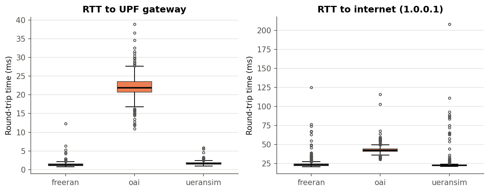
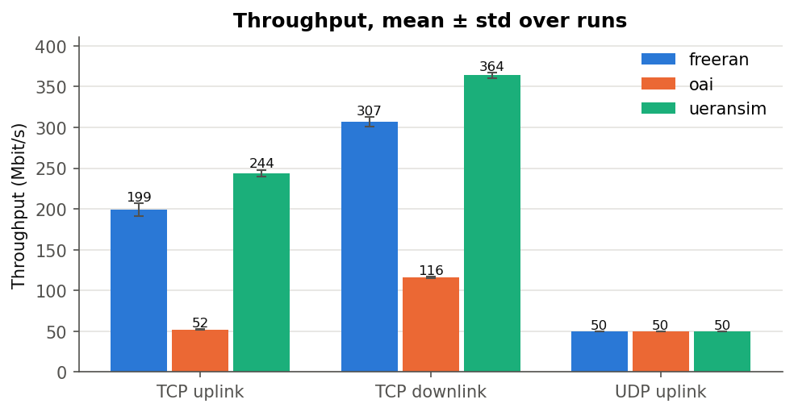
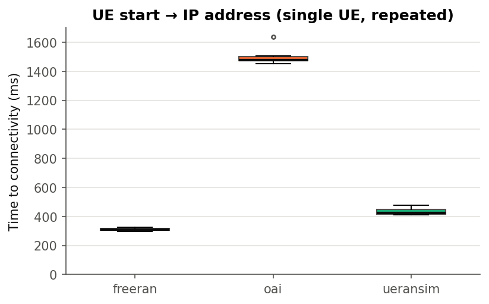
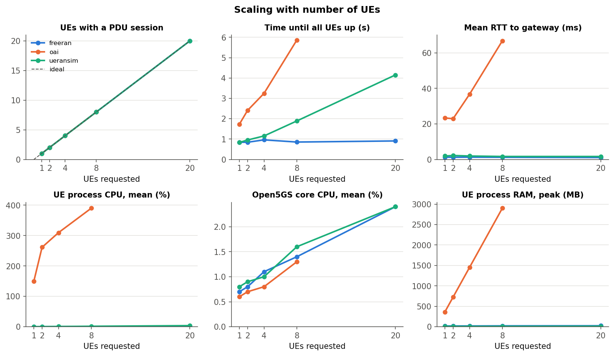

# Comparing open-source 5G UE/RAN simulators on Open5GS

Three open-source 5G UE + gNB simulators, **UERANSIM**, **OpenAirInterface (OAI)** and
**free-ran-ue**, each connected to the same **Open5GS 2.8.0** 5G standalone core on one laptop
and measured with the same tests: latency, throughput, time to connectivity, multi-UE scaling,
and CPU/RAM. Final project for the *5G and Beyond* course, IIT Gandhinagar, 2026.

This repository holds everything needed to reproduce the results: the measurement toolkit,
the configurations, the patches that make free-ran-ue work with Open5GS, the raw results and
the analysis.

## Headline results

Measured on 24 Oct 2026, all three platforms in one session (run tag `consistent`).

| KPI | free-ran-ue | UERANSIM | OAI |
|---|---|---|---|
| RTT to core gateway, mean / p95 (ms) | **1.37** / 1.94 | 1.70 / 2.27 | 22.1 / 26.5 |
| TCP uplink / downlink (Mbit/s) | 199 / 307 | **244 / 364** | 52 / 116 |
| UE start to IP address, mean (ms) | **310** | 433 | 1,508 |
| RTT with 8 UEs pinging at once (ms) | **1.20** | 1.67 | 66.8 |
| RAM, gNB + 1 UE (MB) | 45 | **20** | 2,450 |
| CPU at idle, gNB + 1 UE (cores) | ~0 | ~0 | 3.2 |

The protocol-level simulators (UERANSIM, free-ran-ue) have 13 to 16 times lower latency than
OAI and use 50 to 120 times less memory. OAI is the only one that simulates the radio physical layer,
and its extra ~20 ms of latency appears identically on the gateway and internet paths, i.e. it
comes from the simulated radio link. Full analysis: [docs/report.md](docs/report.md) ([PDF](docs/report.pdf)).

| | |
|---|---|
|  |  |
|  |  |

## Architecture

```
                      control plane (N2: NGAP over SCTP)              ┌── Open5GS 2.8.0 ──────────────┐
 UE ── simulated ── gNB ───────────────────────────────────────────── │ AMF ─ SMF ─ AUSF/UDM/UDR ─ NRF │
 (own netns)  radio  │                                                │        │ N4 (PFCP)             │
                     └──── user plane (N3: GTP-U, UDP 2152) ─────────▶│       UPF ──▶ ogstun 10.45.0.1 │──NAT──▶ internet
                                                                      └────────────────────────────────┘
```

| | UERANSIM | OAI | free-ran-ue |
|---|---|---|---|
| Version | v3.3.0 | `develop` 9313cbea82 (21 Oct 2026) | `main` 7587e14 (22 Oct 2026) + 3 fixes |
| Simulates | Signalling + user plane | Full NR stack incl. physical layer (RF simulator) | Signalling + user plane |
| UE interface / namespace | `uesimtun0` / `ueransim-<imsi>-internet-psi1` | `oaitun_ue1` / `oai-ue` | `ueTun0` / `frue-ue` |
| UE IMSIs | 999700000000001+ | 999700000000100+ | 999700000000110+ |

Every UE runs in its own Linux network namespace; otherwise replies to the UE's address are
delivered locally on the shared host and never cross the 5G user plane. Every test checks the
packet counter on `ogstun` and marks a run invalid if its traffic bypassed the core.

## Repository layout

```
config.env                 settings for all three platforms (PLATFORM=ueransim|oai|freeran)
scripts/
  00_healthcheck.sh        checks core, NAT, processes, tunnel and data path
  01_userplane_setup.sh    IP forwarding + NAT for the UE pool (after every reboot)
  02_add_subscribers.sh    provisions SIMs in Open5GS for the chosen platform
  03_reset_ues.sh          stops all UEs
  04_oai_netns.sh          namespace + veth link for the OAI UE
  05_freeran_netns.sh      namespace + veth link for the free-ran-ue UE
  10_measure_rtt.sh        5 x 100 pings to the gateway and to 1.0.0.1
  11_measure_throughput.sh iperf3 TCP up/down + UDP 50 Mbit/s, 3 x 20 s
  12_measure_attach.sh     10 fresh attaches, time from UE start to IP address
  20_run_scaling.sh        1/2/4/8(/20) UEs at once
  30_capture.sh            pcap of one attach: NGAP/NAS, PFCP, GTP-U (+ QFI check)
  run_baseline.sh          health check + RTT + throughput with CPU/RAM sampling
  resource_sampler.py      CPU/RAM of every 5G process, once per second
analysis/analyze.py        tables, figures and significance tests from results/
patches/free-ran-ue-open5gs.sh   the three fixes free-ran-ue needs for Open5GS
configs/                   gNB/UE configs for each platform, Open5GS notes
results/<platform>/<tag>/  raw measurements (ping logs, iperf3 JSON, CSVs, pcaps)
docs/report.md, report.pdf  the full project report
docs/figures/              the figures above
```

## Reproducing

Tested on Ubuntu 26.04 under WSL2 (Windows 11), 16 threads, 10 GB RAM given to WSL
(`%UserProfile%\.wslconfig`: `memory=10GB`, `swap=8GB`; OAI needs it).

**1. Core and tools**
```bash
# MongoDB 8.0 (repo for Ubuntu 24.04 "noble" on newer releases), then:
sudo add-apt-repository -y ppa:open5gs/latest && sudo apt install -y open5gs
sudo apt install -y iperf3 tcpdump tshark python3-psutil python3-pandas python3-matplotlib python3-tabulate python3-scipy
```

**2. Simulators**
```bash
# UERANSIM
git clone https://github.com/aligungr/UERANSIM ~/UERANSIM && make -C ~/UERANSIM -j$(nproc)
./configs/ueransim/apply.sh
# OAI (45-90 min)
git clone https://gitlab.eurecom.fr/oai/openairinterface5g.git ~/openairinterface5g
cd ~/openairinterface5g/cmake_targets && ./build_oai -I && ./build_oai -w SIMU --gNB --nrUE --ninja && cd -
./configs/oai/make_gnb_conf.sh
# free-ran-ue (needs Go 1.26.2)
git clone https://github.com/free-ran-ue/free-ran-ue.git ~/free-ran-ue
./patches/free-ran-ue-open5gs.sh            # also disables network_name in the AMF
mkdir -p ~/frue-config && cp configs/free-ran-ue/*.yaml ~/frue-config/
```

**3. Subscribers and network setup**
```bash
./scripts/02_add_subscribers.sh 20
PLATFORM=oai ./scripts/02_add_subscribers.sh 8
PLATFORM=freeran ./scripts/02_add_subscribers.sh 20
./scripts/01_userplane_setup.sh && ./scripts/04_oai_netns.sh && ./scripts/05_freeran_netns.sh
```

**4. Run one platform at a time** (start its gNB, then its UE, then measure):

| | gNB | UE |
|---|---|---|
| UERANSIM | `cd ~/UERANSIM && sudo ./build/nr-gnb -c config/open5gs-gnb.yaml` | `sudo ./build/nr-ue -c config/open5gs-ue.yaml` |
| OAI | `cd ~/openairinterface5g/cmake_targets/ran_build/build && sudo ./nr-softmodem -O ~/oai-config/gnb.conf --gNBs.[0].min_rxtxtime 6 --rfsim` | `sudo ip netns exec oai-ue ./nr-uesoftmodem -O ~/oai-config/ue.conf -r 106 --numerology 1 --band 78 -C 3619200000 --ssb 516 --rfsim --rfsimulator.[0].serveraddr 10.201.1.1` |
| free-ran-ue | `cd ~/free-ran-ue && sudo ./build/free-ran-ue gnb -c ~/frue-config/gnb.yaml` | `sudo ip netns exec frue-ue ./build/free-ran-ue ue -c ~/frue-config/ue.yaml` |

```bash
P=freeran   # or ueransim, oai
PLATFORM=$P ./scripts/00_healthcheck.sh && \
for s in run_baseline 12_measure_attach 20_run_scaling 30_capture; do PLATFORM=$P ./scripts/$s.sh consistent; done
python3 analysis/analyze.py --tag consistent --out analysis_consistent
```
The attach, scaling and capture scripts stop and start UEs themselves.

## Making free-ran-ue work with Open5GS

free-ran-ue is developed against free5GC. Three things free5GC accepts are rejected by
Open5GS, which follows 3GPP more strictly. `patches/free-ran-ue-open5gs.sh` fixes all three:

| # | Symptom | Cause | Fix |
|---|---|---|---|
| 1 | UE aborts after Registration Accept: `unsupported code scheme[1]` | Open5GS sends the network name in UCS-2; free-ran-ue's NAS library cannot decode it | Disable `network_name` in `/etc/open5gs/amf.yaml` (cosmetic) |
| 2 | SMF: `No PTI` | PDU Session Establishment Request sent with PTI 0; TS 24.501 requires 1-254 | `PTI: 0x01` in `ue/nas.go` |
| 3 | 100% ping loss; UPF: `Send Error Indication` | Uplink GTP-U has no PDU Session Container, so no QFI; Open5GS's UPF matches uplink packets on QFI (`src/upf/gtp-path.c`) | Add the container with QFI 1 in `gnb/gtp.go` |

## Troubleshooting

| Symptom | Cause | Fix |
|---|---|---|
| `Initial Registration failed [FIVEG_SERVICES_NOT_ALLOWED]` | Core has no subscriber with that IMSI (a digit missing, or MongoDB lost it) | `open5gs-dbctl showfiltered`; re-add; `sudo systemctl enable --now mongod` |
| UERANSIM: `Could not open '/etc/iproute2/rt_tables'` | Newer Ubuntu no longer ships it | `configs/ueransim/apply.sh` |
| Pings via the UE fail, NAT counter stays 0 | UE and core share a network stack | Namespace mode (`useNamespace: true`, scripts 04/05) |
| OAI UE registers but gets no IP | Current OAI ignores top-level `dnn` | `pdu_sessions` block in `ue.conf` (see `configs/oai/ue.conf`) |
| `Cannot open network namespace` after a reboot | Namespaces do not survive restarts | `01_userplane_setup.sh`, `04_oai_netns.sh`, `05_freeran_netns.sh` |
| Health check counts 2 OAI gNBs | OAI forks a child process | Fixed in the toolkit (counts program instances) |

## Limitations

One laptop under WSL2, so absolute numbers are machine-specific. OAI's RF simulator is an ideal
channel. Internet RTT depends on Wi-Fi at the time. free-ran-ue results describe the patched build.
Scaling used one run per UE count, and OAI was tested up to 8 UEs.

## Licence

Toolkit and scripts: MIT (see `LICENSE`). Open5GS, UERANSIM, OAI and free-ran-ue keep their own
licences and are not included here.
