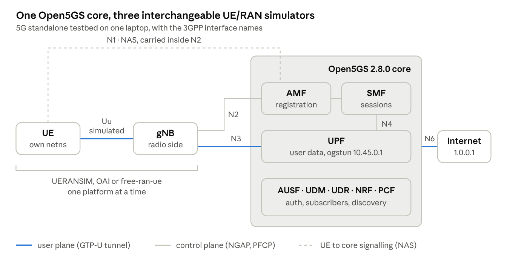
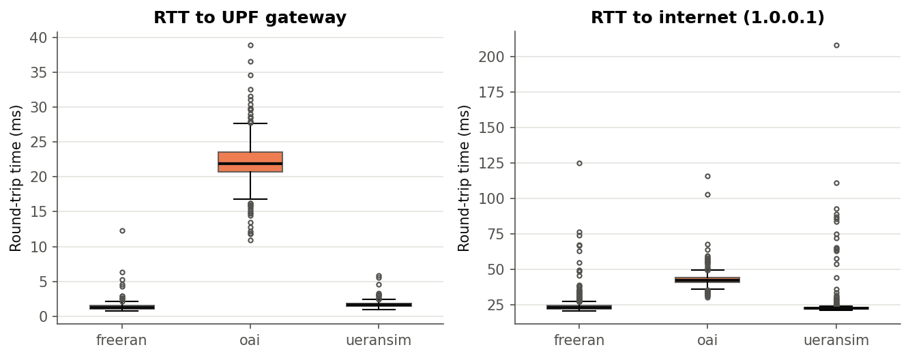
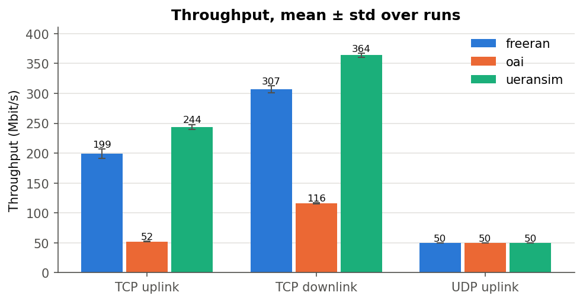
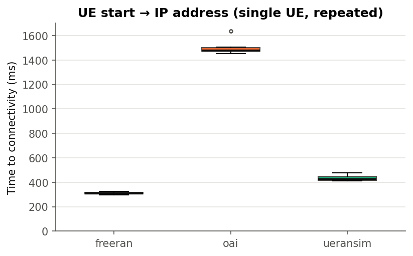
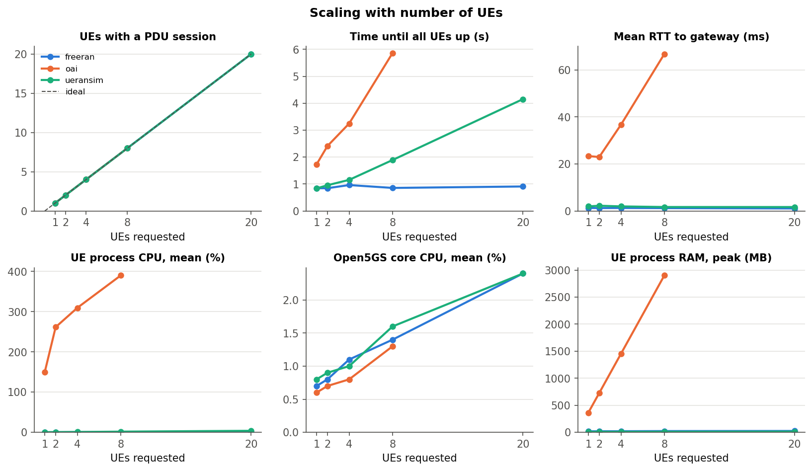

# Qualitative and Quantitative Comparative Analysis of Open-Source 5G UE and RAN Platforms

5G and Beyond course project · October 2026

## Abstract

Open-source simulators let students and researchers run a complete 5G standalone network on one computer, but they differ widely in what they model and what they cost. We connected three open-source UE and RAN simulators, UERANSIM, OpenAirInterface (OAI) and free-ran-ue, to the same Open5GS 2.8.0 core on one laptop and measured them with identical, repeated tests.

The two protocol-level simulators were 13–16× faster than OAI in round-trip time (1.37 and 1.70 ms vs 22.1 ms to the core gateway), had 2.6–4.7× higher TCP throughput, attached 3.5–4.9× faster, and used 50–120× less memory. OAI, the only one that simulates the radio physical layer, paid for that realism with about 3 CPU cores and 2.4 GB of RAM per gNB and UE, and its latency tripled with 8 UEs while the others stayed flat up to 20. All pairwise differences were statistically significant. free-ran-ue needed three protocol fixes to work with Open5GS, which we traced to places where free5GC is more lenient than the 3GPP specifications. A packet capture showed that about 200 ms of the protocol-level simulators' attach time is an SCTP transport artefact rather than simulator work. We conclude that UERANSIM is the best default for core-network testing, free-ran-ue the lightest and fastest option, and OAI the only choice when radio behaviour matters.

## 1. Introduction

Commercial 5G equipment is out of reach for most universities, so teaching and research rely on open-source software that recreates each part of the network: the core, the base station (gNB) and the user equipment (UE). For the core, Open5GS and free5GC are mature and widely used. For the UE and RAN side the choice is harder: some simulators model only the signalling, others the full radio stack, and their documentation rarely says what each costs in latency, throughput, scale or hardware.

**Research question.** Which open-source UE/RAN platform should a student or researcher choose for a 5G testbed, and what do they trade off by choosing it?

**Objectives.**

1. Build one 5G standalone testbed with a single Open5GS core and connect several UE/RAN platforms to it, one at a time.
2. Measure each platform with the same tests: latency, throughput, time to connectivity, multi-UE scaling, and CPU and memory use.
3. Compare the platforms qualitatively: setup effort, configuration, features, maturity and interoperability.
4. Give evidence-based recommendations for which platform suits which use.

**Contributions.**

- A controlled comparison of UERANSIM, OAI and free-ran-ue on one core, one machine and one session, with every test repeated and every pairwise difference tested for significance.
- A diagnosis of three interoperability faults between free-ran-ue and Open5GS, each traced to the responsible line of code and fixed.
- A packet-level explanation of where attach time goes, including a 200 ms SCTP artefact that affects two of the three simulators.
- A reproducible toolkit (scripts, configurations, patches, raw data) published with this report.

A fourth candidate, IoS-MCN, was reviewed but not benchmarked, because it is a full deployment platform rather than a UE/RAN simulator (Section 5).

## 2. Background

### 5G standalone architecture

A 5G standalone (SA) network has three parts: the UE (the phone), the radio access network (the gNB, or base station) and the 5G core. The core is a set of network functions (NFs) that talk to each other over a service-based interface using HTTP/2.

| Network function | Role |
| --- | --- |
| AMF (Access and Mobility Management) | Registers UEs, handles authentication and mobility; ends the UE's NAS signalling and the gNB's NGAP signalling |
| SMF (Session Management) | Creates PDU sessions, assigns the UE's IP address, programs the UPF |
| UPF (User Plane Function) | Forwards the UE's data between the gNB tunnel and the data network |
| AUSF, UDM, UDR | Authentication and subscriber data (the SIM keys) |
| NRF, PCF, NSSF | Service discovery, policy, slice selection |

The parts are joined by interfaces that 3GPP numbers N1 to N6. These are where our packet captures were taken.

| Interface | Between | Protocol |
| --- | --- | --- |
| N1 | UE and AMF | NAS-5GS, carried inside N2 messages |
| N2 | gNB and AMF | NGAP over SCTP, port 38412 |
| N3 | gNB and UPF | GTP-U over UDP, port 2152 |
| N4 | SMF and UPF | PFCP over UDP, port 8805 |
| N6 | UPF and the data network | Plain IP; here via `ogstun` and NAT to the internet |



*Figure: Testbed architecture · one core, one simulator at a time*

The simulator under test supplies the UE and the gNB; everything inside the shaded box is the same Open5GS core for all three platforms.

### Registration and PDU session establishment

Before a UE can send data it completes two procedures, defined in 3GPP TS 23.502 and TS 24.501. These are the steps visible in our captures (Section 4):

1. **Registration request.** The gNB forwards the UE's request to the AMF in an NGAP InitialUEMessage.
2. **Authentication (5G-AKA).** The AMF asks the AUSF and UDM for a challenge built from the SIM's key K and OPc; the UE answers it.
3. **Security mode.** The AMF and UE agree on integrity protection and ciphering for NAS.
4. **Registration accept.** Sent with an InitialContextSetupRequest that also sets up security on the radio side; the UE confirms with Registration complete.
5. **PDU session request.** The UE asks for a data session on a data network name (DNN, here `internet`) and slice (S-NSSAI, here SST 1).
6. **Session setup in the core.** The SMF picks the UPF and installs packet rules with a PFCP Session Establishment.
7. **Resource setup.** The AMF sends the gNB the UPF's tunnel endpoint and the UE its IP address; the gNB replies with its own tunnel endpoint, which the SMF passes to the UPF in a PFCP Session Modification. Data can now flow.

### GTP-U tunnels and QoS flows

User data between gNB and UPF travels inside GTP-U tunnels. Each direction is identified by a tunnel endpoint identifier (TEID). 5G adds a PDU Session Container extension header that carries the QoS Flow Identifier (QFI) of each packet; the default flow has QFI 1. The UPF matches incoming packets to packet detection rules (PDRs) by TEID and, in Open5GS, also by QFI. This detail turned out to matter for free-ran-ue (Section 5).

### Two kinds of UE/RAN simulator

- **Protocol-level simulators** (UERANSIM, free-ran-ue) implement the signalling (NAS, NGAP, and in UERANSIM's case RRC) and the GTP-U user plane. The radio link between UE and gNB is replaced by a UDP or TCP socket, so there is no modulation, scheduling or radio timing. They are light and fast but say nothing about radio behaviour.
- **Physical-layer simulators** (OAI) implement the full 5G NR stack: PHY, MAC, RLC, PDCP, SDAP and RRC. With the RF simulator, the gNB and UE exchange the radio signal as digital samples over a TCP socket instead of through radio hardware. Timing follows the real slot structure, at the price of heavy computation. The same code can drive software-defined radios such as USRPs.

## 3. Testbed and methodology

All three simulators ran one at a time against the same Open5GS 2.8.0 core on one laptop (ASUS G14, Ubuntu 26.04 on WSL2, 16 threads, 10 GB RAM for WSL), in one session on 24 Oct 2026.

| Platform | Version tested | Language | What it simulates | UE data path |
| --- | --- | --- | --- | --- |
| UERANSIM | v3.3.0 | C++ | NAS, RRC and NGAP signalling + GTP-U; no physical layer | `uesimtun0` in its own namespace (`useNamespace: true`) |
| OAI | `develop`, commit 9313cbea82 (21 Oct 2026) | C | Full 5G NR stack including the physical layer, over the RF simulator | `oaitun_ue1` in namespace `oai-ue` |
| free-ran-ue | `main`, commit 7587e14 (22 Oct 2026), plus 3 fixes | Go | NAS and NGAP signalling + GTP-U; no physical layer | `ueTun0` in namespace `frue-ue` |

Every UE ran in a separate Linux network namespace. Otherwise replies to the UE's address are delivered locally and never cross the 5G user plane. Each test also checked the packet counter on Open5GS's `ogstun` interface and discarded any run where traffic bypassed the core; none had to be discarded.

| KPI | Method | Repeats |
| --- | --- | --- |
| Round-trip time, jitter, loss | `ping` from the UE to the core gateway (10.45.0.1) and to 1.0.0.1 | 5 runs × 100 pings per target |
| Throughput | `iperf3` TCP uplink, TCP downlink, UDP uplink at 50 Mbit/s, 20 s each | 3 runs per test |
| Time to connectivity | Start a fresh UE; time until its tunnel has an IP address | 10 attaches |
| Scalability | Start N UEs at once; count PDU sessions, time until all are up, concurrent ping | N = 1, 2, 4, 8 (+20 for UERANSIM and free-ran-ue) |
| CPU and RAM | Every gNB, UE and core process sampled once per second | During all tests |

### Hardware and software

| Item | Version or setting |
| --- | --- |
| Host | ASUS G14 laptop, 16 hardware threads, Windows with WSL2 |
| Linux | Ubuntu 26.04.1 LTS under WSL2; 10 GB RAM and 8 GB swap assigned to WSL |
| 5G core | Open5GS 2.8.0 (Ubuntu PPA), MongoDB 8.0 |
| UERANSIM | v3.3.0, built with `make` |
| OAI | `develop` branch, commit 9313cbea82 (21 Oct 2026), built with `build_oai -w SIMU --gNB --nrUE` |
| free-ran-ue | `main` branch, commit 7587e14 (22 Oct 2026), Go 1.26.2, three patches (Section 5) |
| Tools | iperf3, tcpdump, tshark, Python 3 with pandas, SciPy, Matplotlib and psutil |

### Network design

All NFs and simulators run on one Linux host, with the core on loopback addresses: AMF (NGAP) 127.0.0.5, SMF (PFCP) 127.0.0.4 and UPF (GTP-U) 127.0.0.7. The UEs get addresses from 10.45.0.0/16, which the UPF serves through the `ogstun` interface (10.45.0.1); iptables NAT forwards that pool to the internet. All platforms use PLMN 999/70, TAC 1, slice SST 1 and DNN `internet`, and each has its own subscriber range (UERANSIM 999700000000001+, OAI …100+, free-ran-ue …110+), all with the same test key and OPc.

On a single host, a UE's tunnel address is also a local address, so the kernel would deliver replies to the UE directly instead of sending them back through the GTP tunnel. To prevent this, every UE runs in its own network namespace:

- **UERANSIM** creates one per UE itself (`useNamespace: true`).
- **OAI and free-ran-ue** run inside a namespace we create, joined to the host by a veth pair that carries the simulated radio link: 10.201.1.0/30 for OAI's RF simulator and 10.202.1.0/30 for free-ran-ue's RAN connection. A default route inside the namespace points at the UE's tunnel.

### Measurement procedure

All final measurements were taken in one session on 24 Oct 2026, in the order free-ran-ue, UERANSIM, OAI, with the laptop on mains power, other applications closed and the same Wi-Fi network. For each platform we ran, in order:

1. A health check of every link: core services, `ogstun`, NAT, simulator processes, the UE tunnel, and pings through it.
2. **RTT:** 5 runs of 100 pings at 0.2 s intervals to the gateway (10.45.0.1) and to 1.0.0.1, sent from inside the UE namespace.
3. **Throughput:** iperf3 with the server bound to 10.45.0.1 and the client in the UE namespace: TCP uplink, TCP downlink (`-R`) and UDP uplink at 50 Mbit/s, 3 runs of 20 s each.
4. **Time to connectivity:** 10 times, stop the UE, wait 4 s, start a fresh UE, and time until its tunnel has an IPv4 address (polled every 0.1 s).
5. **Scalability:** for N = 1, 2, 4, 8 and (where feasible) 20, start N UEs at once, time until all have an address, ping the gateway from all of them at once (20 pings each), then sample 30 s of steady state.
6. **Packet capture** of one fresh attach and 5 pings on all interfaces (NGAP, PFCP, GTP-U), taken separately on 25 Oct 2026.

CPU and RAM of every gNB, UE and core process were sampled once per second with psutil throughout steps 2, 3 and 5. CPU is reported in percent of one core. A forked child process is counted with its parent, so memory is not double-counted.

### Validity checks

Every ping and iperf3 run recorded the packet counter of `ogstun` before and after. A run in which no packets crossed the UPF would have been marked invalid and excluded; none had to be. Open5GS ran with an identical configuration for all three platforms, with `network_name` disabled because free-ran-ue needs it (Section 5).

### Statistical methods

Each pair of platforms was compared on every KPI. For RTT (500 pings per platform and target) and time to connectivity (10 attaches), we used the two-sided Mann-Whitney U test, which assumes no particular distribution. We report the difference in medians with a 95% bootstrap confidence interval (2,000 resamples) and the rank-biserial effect size r = P(A > B) − P(A < B). For throughput (3 runs each) we used Welch's t-test on the means. p-values were corrected for the 15 comparisons with the Holm–Bonferroni method. Consecutive pings are not fully independent, so the RTT p-values are optimistic; we judge those differences mainly by effect size and confidence interval.

## 4. Results

### At a glance

free-ran-ue leads on latency and attach time, UERANSIM on throughput, and OAI trails on every KPI while being the only one that simulates the radio.

| KPI | free-ran-ue | UERANSIM | OAI |
| --- | --- | --- | --- |
| RTT to core gateway, mean / p95 (ms) | **1.37** / 1.94 | 1.70 / 2.27 | 22.1 / 26.5 |
| RTT to 1.0.0.1, mean / p95 (ms) | 25.0 / 33.2 | **24.8** / 28.2 | 43.3 / 49.4 |
| TCP uplink (Mbit/s) | 199 | **244** | 52 |
| TCP downlink (Mbit/s) | 307 | **364** | 116 |
| UDP 50 Mbit/s: jitter (ms) / loss (%) | 0.053 / 0 | **0.041** / 0.014 | 0.306 / 0 |
| UE start to IP address, mean (ms) | **310** | 433 | 1,508 |
| Attach success | 10/10 | 10/10 | 10/10 |
| Largest UE count tested, all connected | 20 | 20 | 8 |
| RTT with 8 UEs pinging at once (ms) | **1.20** | 1.67 | 66.8 |
| RAM, gNB + 1 UE, mean (MB) | 45 | **20** | 2,450 |

All packet loss in the ping tests was 0%. Bold marks the best value per row.

### Latency

OAI adds about 20 ms of round-trip time that the two protocol-level simulators do not have: 22.1 ms to the core gateway against 1.70 ms for UERANSIM and 1.37 ms for free-ran-ue.



*Figure: Round-trip time to the core gateway and to 1.0.0.1, 500 pings per platform and target*

**Where OAI's extra delay comes from.** OAI simulates the radio frame structure. Uplink data must wait for an uplink slot in the TDD pattern (7 downlink slots, 2 uplink slots and 1 mixed slot per 5 ms), go through scheduling, and be processed sample by sample. UERANSIM and free-ran-ue pass each packet straight to the gNB over a UDP or TCP socket, so their delay is mostly socket and process-switching time on the laptop.

**A consistency check.** OAI's gap over UERANSIM is 20.4 ms to the gateway and 18.5 ms to 1.0.0.1. The gap is almost the same on both paths, so it comes from the simulated radio link, not from the core or the internet.

**free-ran-ue vs UERANSIM.** free-ran-ue is 0.33 ms faster on average (1.37 vs 1.70 ms) but has a longer tail: its p99 is 2.93 ms and its maximum 12.3 ms, against 3.11 ms and 5.82 ms for UERANSIM. Both differences are small next to OAI's.

**Internet RTT** is about 25 ms for the two protocol-level simulators and 43 ms for OAI. Most of it is the laptop's Wi-Fi and the path to 1.0.0.1, which is why its spikes (up to 208 ms) appear on all platforms. The gateway RTT is the cleaner comparison of the simulators.

### Throughput

UERANSIM moved the most data (244 Mbit/s up, 364 Mbit/s down), free-ran-ue reached about 83% of that, and OAI managed 52 and 116 Mbit/s. All three carried a 50 Mbit/s UDP stream without meaningful loss.



*Figure: TCP and UDP throughput, mean ± standard deviation over 3 runs of 20 s*

- **OAI is capped by its simulated radio.** Each packet goes through modulation, coding and the slot schedule of a 106-resource-block cell (about 40 MHz at 30 kHz spacing), all computed on the CPU. Its uplink is lower than its downlink because the TDD pattern gives uplink fewer slots.
- **UERANSIM and free-ran-ue are capped by the laptop.** They only copy packets between sockets and the GTP tunnel, so their limit is how fast one process can do that. UERANSIM (C++) is about 20% faster than free-ran-ue (Go) at it.
- **Jitter at 50 Mbit/s** was 0.04–0.05 ms for the protocol-level simulators and 0.31 ms for OAI: still small, but 6–7× higher because of slot timing.
- **Run-to-run spread** was small: the standard deviation was at most 4% of the mean on every platform.

These are simulator ceilings on this laptop, not 5G performance: a real 106-RB cell's capacity depends on the radio, not on the simulator's CPU.

### Time to connectivity

A fresh UE had an IP address after 310 ms with free-ran-ue, 433 ms with UERANSIM and 1,508 ms with OAI, and all 30 attaches succeeded.



*Figure: Time from starting a UE until its tunnel has an IP address, 10 attaches per platform*

The metric covers everything a phone does after switching on: finding the cell, registration with authentication, the PDU session, and creating the tunnel. It is measured the same way on all three, from outside the simulators.

- **OAI** spends most of its extra second on the radio side: cell search and synchronisation, then random access, before any signalling reaches the core.
- **UERANSIM's logs** split its 433 ms: registration takes 38 ms and the PDU session 217 ms. The rest is process start-up and tunnel creation.
- **free-ran-ue** is the fastest. It has no simulated cell search, and its UE and gNB talk over a direct socket connection.

The spread was tight on all three: the slowest of 10 attaches was within 12% of the median for UERANSIM, 11% for OAI and 6% for free-ran-ue.

### Signalling flow captured on the core

All three platforms follow the same 3GPP message sequence, but UERANSIM and free-ran-ue stall for about 200 ms in the middle of it. That stall is a transport effect, not simulator work.

The table gives the time of each message on the N2 and N4 interfaces, in ms after the gNB's first message (InitialUEMessage), from one packet capture per platform.

| Message (sender) | free-ran-ue | UERANSIM | OAI |
| --- | --- | --- | --- |
| Authentication request (AMF) | 50.6 | 21.1 | 39.1 |
| Security mode command (AMF) | 64.1 | 31.8 | 82.0 |
| Registration accept + InitialContextSetupRequest (AMF) | 94.0 | 48.4 | 138.2 |
| InitialContextSetupResponse (gNB) | 94.8 | 48.8 | 191.2 |
| Registration complete (gNB) | **301.2** | **250.0** | 216.9 |
| PDU session establishment request (gNB) | 304.0 | 250.0 | 216.9 |
| PFCP session establishment response (UPF) | 344.8 | 264.2 | 254.2 |
| PDU session establishment accept (AMF) | 353.4 | 266.2 | 257.8 |
| PDUSessionResourceSetupResponse (gNB) | 355.6 | 267.0 | 292.1 |

**The 200 ms stall.** After sending InitialContextSetupResponse, the UERANSIM and free-ran-ue gNBs wait 201 and 206 ms before sending Registration complete; OAI waits 26 ms. The most likely cause is the Linux SCTP stack. By default it holds back a small message while an earlier one is still unacknowledged, and the receiver delays its acknowledgement by up to 200 ms (`net.sctp.sack_timeout`). Two signs support this: the delay is almost exactly 200 ms on both simulators, and UERANSIM's Registration complete and PDU session request leave together in one packet once the hold-up clears. OAI apparently disables this behaviour on its SCTP socket.

**What this means for the attach KPI.** About 200 ms of UERANSIM's 433 ms and free-ran-ue's 310 ms time to connectivity is this stall. It also explains UERANSIM's log, which reports 217 ms for the PDU session, although the core answered the request in about 16 ms.

**The core itself is fast.** Open5GS's own processing on the path (from each message arriving at the AMF to the core's reply, summed over the six exchanges) was 62 ms with UERANSIM, 135 ms with OAI and 139 ms with free-ran-ue. With one capture per platform, the spread between these is not meaningful.

**Two protocol details stood out.** OAI also sends a UERadioCapabilityInfoIndication, because it models the UE's radio capabilities. free-ran-ue marks its registration with the RRC establishment cause `mt-Access` (mobile-terminated), although the UE initiated it; UERANSIM and OAI correctly use `mo-Signalling`. Open5GS accepts both.

These captures were taken a day after the benchmark runs, one attach per platform, so their absolute times differ slightly from the means above; the sequence and the stall are the point. The QFI fix for free-ran-ue was verified on the UPF: before it, every uplink packet triggered a GTP-U Error Indication; after it, none did and all pings succeeded.

### Scalability

All three connected every UE they were given, but only the protocol-level simulators stayed flat: OAI's RTT tripled from 23 ms with 1 UE to 67 ms with 8, while UERANSIM and free-ran-ue stayed under 2.3 ms up to 20 UEs.



*Figure: Scaling from 1 to 20 UEs: sessions, time until all are up, RTT, CPU and RAM*

| UEs | free-ran-ue: all up (s) / RTT (ms) | UERANSIM: all up (s) / RTT (ms) | OAI: all up (s) / RTT (ms) |
| --- | --- | --- | --- |
| 1 | 0.84 / 1.27 | 0.84 / 1.93 | 1.73 / 23.3 |
| 2 | 0.85 / 1.23 | 0.96 / 2.22 | 2.41 / 22.9 |
| 4 | 0.96 / 1.27 | 1.15 / 1.94 | 3.25 / 36.7 |
| 8 | 0.86 / 1.20 | 1.89 / 1.67 | 5.87 / 66.8 |
| 20 | 0.91 / 1.06 | 4.15 / 1.66 | not tested |

- **OAI hits the laptop's CPU limit.** Each OAI UE simulates its own radio receiver, so CPU and RAM grow with every UE (RAM about 363 MB per UE). With 8 UEs the gNB and UEs share about 5.7 cores, and slots start to run late, which shows up as latency.
- **free-ran-ue attaches all UEs in under 1 s at every size**, because it was told to start them all in parallel (`-p N`). UERANSIM's time grows from 0.84 s to 4.15 s, which is closer to how a real cell admits UEs one after another.
- **The core was never the bottleneck.** Open5GS used at most 2.4% CPU, even with 20 UEs.

OAI was stopped at 8 UEs. Its latency had already tripled, and at about 363 MB per UE plus 2.1 GB for the gNB, 20 UEs would need roughly 9.4 GB, nearly all of the 10 GB given to WSL. Its UE CPU also grew less than in proportion (150% for 1 UE, 390% for 8), a sign the processes were already competing for cores.

### Resource use

OAI needs about 2.4 GB of RAM and 3 CPU cores just to keep one idle UE connected; UERANSIM and free-ran-ue need under 50 MB and almost no CPU when idle.

| Component (1 UE) | free-ran-ue | UERANSIM | OAI |
| --- | --- | --- | --- |
| gNB CPU, idle (% of one core) | 0.1 | 0.2 | 165 |
| UE CPU, idle (% of one core) | 0.0 | 0.3 | 150 |
| gNB CPU, mean / peak during tests (%) | 72 / 208 | 74 / 232 | 231 / 363 |
| UE CPU, mean / peak during tests (%) | 63 / 180 | 83 / 285 | 205 / 366 |
| gNB RAM, peak (MB) | 28 | 12 | 2,085 |
| UE RAM, peak (MB) | 25 | 9 | 374 |
| RAM per extra UE (MB) | 0.3 | 0.2 | 363 |
| Open5GS core CPU, mean during tests (%) | 29 | 34 | 11 |
| Total RAM in use in WSL, peak (GB) | 1.25 | 1.34 | 3.79 |

CPU is given in percent of one core, so 231% means 2.3 cores. "Idle" is the steady state with one connected UE and no traffic; "during tests" is the mean over the ping and iperf3 runs.

- **OAI's cost is constant, not traffic-driven.** It computes the radio signal for every slot whether or not data is flowing, so it burns about 3 cores even when idle.
- **The protocol-level simulators only work when there is traffic.** Their CPU during the tests comes from moving 200–360 Mbit/s through iperf3.
- **The core's CPU follows the traffic**, not the simulator: Open5GS worked harder with UERANSIM and free-ran-ue (29–34%) because they pushed 3–5× more data through its UPF than OAI did.
- **free-ran-ue uses about twice UERANSIM's RAM** (53 vs 21 MB for gNB + UE), which is typical of Go's runtime against C++. Both are negligible on a laptop.

### Statistical significance

All 15 pairwise differences are significant after Holm correction (largest corrected p = 0.0027), including the smallest one, free-ran-ue's 0.35 ms latency lead over UERANSIM.

| Comparison (A − B) | Difference, 95% CI | Effect size r | Holm p |
| --- | --- | --- | --- |
| Gateway RTT, free-ran-ue − UERANSIM | −0.35 ms \[−0.40, −0.30\] | −0.59 | 5 × 10⁻⁵⁸ |
| Gateway RTT, OAI − UERANSIM | +20.26 ms \[20.03, 20.49\] | +1.00 | 9 × 10⁻¹⁶⁴ |
| Internet RTT, free-ran-ue − UERANSIM | +0.50 ms \[0.40, 0.70\] | +0.31 | 4 × 10⁻¹⁶ |
| Internet RTT, OAI − UERANSIM | +20.0 ms \[19.8, 20.3\] | +0.94 | 4 × 10⁻¹⁴⁴ |
| Time to connectivity, free-ran-ue − UERANSIM | −117 ms \[−143, −102\] | −1.00 | 0.0013 |
| Time to connectivity, OAI − UERANSIM | +1,051 ms \[1,024, 1,127\] | +1.00 | 0.0013 |
| TCP uplink, free-ran-ue − UERANSIM | −44.2 Mbit/s \[−60.1, −28.3\] | – | 0.0027 |
| TCP downlink, free-ran-ue − UERANSIM | −57.1 Mbit/s \[−69.5, −44.7\] | – | 0.0019 |
| TCP uplink, OAI − UERANSIM | −191.4 Mbit/s \[−202.3, −180.6\] | – | 0.0013 |
| TCP downlink, OAI − UERANSIM | −247.8 Mbit/s \[−254.7, −240.9\] | – | 5 × 10⁻⁵ |

RTT and time to connectivity: Mann-Whitney U, median difference. Throughput: Welch's t-test, difference of means (3 runs each). The free-ran-ue vs OAI comparisons, also all significant, follow from the two rows above them and are in `stat_tests.csv`.

- **free-ran-ue's latency lead is real.** An effect size of −0.59 means a free-ran-ue ping beats a UERANSIM ping about 80% of the time, and the interval excludes zero by a wide margin.
- **The internet RTT difference between the two is significant but negligible.** UERANSIM was 0.5 ms faster on a 25 ms path dominated by Wi-Fi; it says more about the moment than the simulator.
- **The attach times do not overlap at all** (r = ±1): every free-ran-ue attach was faster than every UERANSIM attach, and every UERANSIM attach faster than every OAI attach.
- **Throughput differences rest on only 3 runs**, which shows in the wider intervals, but they are large enough that the conclusion does not change.

Because consecutive pings are correlated, the RTT p-values overstate the evidence; the effect sizes and intervals are the safer guide.

## 5. Discussion

### Qualitative comparison

UERANSIM was the easiest to run against Open5GS, OAI the hardest to build and run, and free-ran-ue the only one that needed code changes.

| Aspect | UERANSIM | OAI | free-ran-ue |
| --- | --- | --- | --- |
| What it models | Signalling + user plane; no radio | Full 5G NR stack including the radio physical layer | Signalling + user plane; no radio |
| Build | `make`, a few minutes | `build_oai -I` (dependencies) then `build_oai`, 45–90 min | `make` with Go 1.26.2, a few minutes |
| Configuration | YAML | libconfig `.conf`; format changes between versions | YAML |
| Works with Open5GS as shipped | Yes | Yes, after editing addresses and PLMN | No: 3 fixes needed (next section) |
| Same-host setup | Built-in `useNamespace` option | Namespace and veth link set up by hand | Namespace and veth link set up by hand |
| Multiple UEs | One process, `-n N` | One process per UE, each in its own namespace | One process, `-n N`, parallel start with `-p N` |
| Notable features | Mature, widely used in tutorials and core testing | Real-radio path: the same code drives SDR hardware such as USRPs | NR dual connectivity (NR-DC), web console |
| Hardware need, 1 UE | Negligible | About 3 cores and 2.5 GB | Negligible |
| Licence | GPL-3.0 | OAI Public License v1.1 | Apache-2.0 |
| Issues hit in this project | Missing `/etc/iproute2/rt_tables` on Ubuntu 26.04; replies bypassing the tunnel until `useNamespace` was on | WSL memory raised to 10 GB to build; UE config needed the new `pdu_sessions` block; `--ssb 516` required | UCS-2 network name, PTI = 0, missing QFI in uplink packets |

OAI's documentation is the most extensive but tied to specific versions. Its tutorials use flags and a UE config format that the current `develop` branch no longer needs (`--sa` is now the default) or silently ignores (a top-level `dnn` instead of a `pdu_sessions` block), which left the UE registered but without a data session. free-ran-ue's user guide is clear but written only for free5GC.

### Interoperability: free-ran-ue on Open5GS

free-ran-ue is developed and tested against free5GC, and it needed three fixes to work with Open5GS. In each case free5GC accepts something that Open5GS, following the 3GPP specifications more strictly, rejects.

| # | Symptom | Cause | Fix |
| --- | --- | --- | --- |
| 1 | UE aborts right after Registration Accept: `decodeStrByCodeScheme(): unsupported code scheme[1]` | Open5GS sends the network name in UCS-2 in the Configuration Update Command; free-ran-ue's NAS library cannot decode that encoding | Comment out `network_name` in `/etc/open5gs/amf.yaml` (it is only the operator name shown on the phone) |
| 2 | PDU session refused; SMF logs `No PTI` | The UE sends the PDU Session Establishment Request with procedure transaction identity 0; TS 24.501 requires a UE to pick 1–254 | Set `PTI: 0x01` in `ue/nas.go` |
| 3 | Session up, but 100% ping loss; UPF logs `Send Error Indication [TEID:…]` | Uplink GTP-U packets carry no PDU Session Container, so no QoS flow ID; Open5GS's UPF matches uplink packets on QFI and drops them | Add the 4-byte container with QFI = 1 in `gnb/gtp.go` |

Each fix was traced to the exact line: the AMF and SMF logs for fixes 1 and 2, and the QFI check in Open5GS 2.8.0's `src/upf/gtp-path.c` for fix 3. All three are applied by `patches/free-ran-ue-open5gs.sh` in the project toolkit, so the setup can be reproduced.

To keep the comparison fair, `network_name` stayed disabled for all three platforms in the final runs. UERANSIM and OAI worked with Open5GS without any code changes.

### Which simulator for which job

The choice depends on whether the radio matters to the question being asked.

| If you want to… | Use | Why |
| --- | --- | --- |
| Test a 5G core: registration, sessions, many subscribers, automated tests | UERANSIM | Works with Open5GS as shipped, highest throughput, mature, about 0.2 MB per extra UE |
| Run many UEs quickly, try NR dual connectivity, or work with free5GC | free-ran-ue | Fastest attach (310 ms, flat up to 20 UEs), lowest latency, Go code that is easy to extend; expect integration work with other cores |
| Study anything that depends on the radio: scheduling, HARQ, slot timing, realistic latency, or move to real SDR hardware later | OAI | The only one that simulates the physical layer; budget about 3 cores and 2.5 GB per gNB + UE, and about 360 MB more per extra UE |
| Teach or demo 5G on a student laptop | UERANSIM or free-ran-ue | Start in seconds and run alongside the core with RAM to spare |

The two protocol-level simulators are close enough on performance (0.33 ms apart in latency, about 20% apart in throughput, 123 ms apart in attach time) that the deciding factor between them is maturity and core compatibility, where UERANSIM is ahead.

### IoS-MCN: reviewed, not tested

IoS-MCN was compared on paper only, because it is a full private-5G deployment platform rather than a UE/RAN simulator, so benchmarking it next to the other three would not be like for like.

- **What it is:** the Indian Open Source for Mobile Communication Networks consortium, funded by MeitY and led by IISc Bengaluru, IIT Delhi and C-DAC. Its fourth release, Agartala 0.4.0, came out in January 2026 ([Open Source For You](https://www.opensourceforu.com/2026/01/meity-backed-agartala-0-4-0-aims-to-power-indias-private-5g-rollout/)).
- **What it contains:** an O-RAN-compliant disaggregated RAN, network slicing, service management and orchestration (SMO), a RAN Intelligent Controller framework and VoNR with IMS. It is deployed with Kubernetes and Docker ([O-RAN SC documentation](https://docs.o-ran-sc.org/en/latest/user-experience/iosmcn/iosmcn.html)).
- **Its RAN is based on OAI:** the management layer configures an OAI gNB through an O1 adapter, so its radio behaviour would largely repeat the OAI results above.
- **Why it was not run:** it targets multi-server and hardware deployments, and the sources reviewed document no UE simulator or single-laptop setup.

The right comparison for IoS-MCN would be against other complete open-source 5G platforms, not against UE/RAN simulators.

## 6. Limitations

The results compare the three simulators fairly against each other, but the absolute numbers belong to this laptop and setup.

- **One machine under WSL2.** Absolute latency and throughput depend on the CPU and on virtualisation overhead; the ranking should hold elsewhere, the numbers will not.
- **Ideal simulated radio.** OAI's RF simulator gives a perfect channel (SINR about 44 dB, CQI 15), with no fading, interference or mobility. Real-radio OAI would be slower still.
- **Internet RTT depends on Wi-Fi and the ISP** at the time of the run; the gateway RTT is the reliable comparison.
- **free-ran-ue was patched** in three places to work with Open5GS, so its results describe the patched build.
- **Core configuration:** `network_name` was disabled in the AMF for all three platforms.
- **Scalability:** one run per UE count; OAI was tested up to 8 UEs only; free-ran-ue started its UEs in parallel, which favours its "time until all up".
- **Sampling:** CPU and RAM were sampled once per second, with CPU as percent of one core. Throughput used a single TCP stream per test.

## 7. Conclusion and future work

The three simulators sit at two very different points of a realism–cost trade-off, and the measurements put numbers on it. UERANSIM and free-ran-ue model only the signalling, so they reach a core-network test quickly, cheaply and at scale: about 2 ms of latency, 200–360 Mbit/s, and 20 UEs in under 50 MB. OAI models the radio itself, so it is an order of magnitude slower and heavier, about 22 ms, 50–120 Mbit/s and 2.4 GB for one UE, and stops scaling on a laptop at a handful of UEs. All differences were statistically significant.

The answer to the research question is therefore a choice by purpose:

- **UERANSIM** is the best default for testing a 5G core: it worked with Open5GS without changes, had the highest throughput and is the most mature.
- **free-ran-ue** was the fastest and lightest in signalling, but needed three fixes before it worked with Open5GS; it suits free5GC users and work on NR dual connectivity.
- **OAI** is the only option when radio behaviour matters, and the only one that can move to real radio hardware.

Two results go beyond the benchmark. The free-ran-ue fixes show that a simulator developed against one core can silently depend on that core's leniency; testing against more than one core is the remedy. The packet capture showed that a 200 ms SCTP stall inflates the attach time of two simulators, which any study comparing attach times should control for.

**Future work.**

1. Repeat the comparison on free5GC, to separate simulator effects from core effects and to confirm that free-ran-ue needs no patches there.
2. Disable the SCTP hold-up (`SCTP_NODELAY` in the gNB, or a lower `net.sctp.sack_timeout`) and remeasure attach times.
3. Run OAI with a real software-defined radio (for example a USRP) to measure how far the RF simulator's ideal channel flatters it.
4. Move the testbed from WSL2 to native Linux or separate machines, and repeat the scaling tests with several runs per step.
5. Evaluate IoS-MCN as a complete platform against other end-to-end open-source 5G deployments.

## References

- Measurements: the project's `5g-kpi-bench` toolkit, run tag `consistent` (24 Oct 2026); raw results in `results/<platform>/consistent/`.
- [OAI: NR SA tutorial for the OAI nrUE](https://raw.githubusercontent.com/OPENAIRINTERFACE/openairinterface5g/develop/doc/NR_SA_Tutorial_OAI_nrUE.md) (RF simulator commands, SA mode default)
- [OAI: running the nrUE, `pdu_sessions` configuration](https://raw.githubusercontent.com/OPENAIRINTERFACE/openairinterface5g/develop/doc/runmodem-nrue.md)
- [OAI: supported distributions in `build_helper`](https://raw.githubusercontent.com/OPENAIRINTERFACE/openairinterface5g/develop/cmake_targets/tools/build_helper)
- [UERANSIM on GitHub](https://github.com/aligungr/UERANSIM) and its [Open5GS UE configuration](https://raw.githubusercontent.com/aligungr/UERANSIM/master/config/open5gs-ue.yaml) (`useNamespace`)
- [free-ran-ue on GitHub](https://github.com/free-ran-ue/free-ran-ue) and its [user guide](https://free-ran-ue.github.io/doc-user-guide/02-free-ran-ue/)
- [Open5GS 2.8.0 UPF source, `src/upf/gtp-path.c`](https://github.com/open5gs/open5gs/blob/v2.8.0/src/upf/gtp-path.c) (QFI check behind fix 3)
- [IoS-MCN Agartala 0.4.0 (Open Source For You)](https://www.opensourceforu.com/2026/01/meity-backed-agartala-0-4-0-aims-to-power-indias-private-5g-rollout/)
- [IoS-MCN user experience (O-RAN SC documentation)](https://docs.o-ran-sc.org/en/latest/user-experience/iosmcn/iosmcn.html)

Standards referred to in the text: 3GPP TS 23.501 (5G system architecture), TS 23.502 (procedures for the 5G system, including registration and PDU session establishment), TS 24.501 (NAS protocol for 5GS) and TS 29.281 (GTP-U, including the PDU Session Container extension header).

## Appendix A. Reproducing the results

Everything needed to repeat the study is in the project repository: the measurement toolkit, the configurations for all three platforms, the free-ran-ue patch script, the raw results of every run, and this report's figures.

| Path | Contents |
| --- | --- |
| `config.env` | Settings for all three platforms; choose one with `PLATFORM=ueransim`, `oai` or `freeran` |
| `scripts/` | Health check, network setup, subscriber provisioning, RTT, throughput, attach, scaling and capture scripts |
| `analysis/analyze.py` | Builds every table, figure and significance test in this report from `results/` |
| `patches/free-ran-ue-open5gs.sh` | Applies the three free-ran-ue fixes and rebuilds it |
| `configs/` | gNB and UE configurations for each platform, and notes on the Open5GS settings |
| `results/<platform>/consistent/` | Raw data of the final runs: ping logs, iperf3 JSON, attach CSVs, scaling logs, CPU/RAM samples, packet captures |

The full run for one platform, after its gNB and UE are started, is:

```bash
PLATFORM=freeran ./scripts/00_healthcheck.sh && \
for s in run_baseline 12_measure_attach 20_run_scaling 30_capture; do PLATFORM=freeran ./scripts/$s.sh consistent; done
python3 analysis/analyze.py --tag consistent --out analysis_consistent
```

## Appendix B. Problems encountered and how they were solved

Setting up three simulators on one machine surfaced a series of problems. Each is listed here because anyone repeating the work will likely meet it too.

| Problem | Symptom | Cause | Fix |
| --- | --- | --- | --- |
| MongoDB install failed | `mongodb-org has no installation candidate` | No MongoDB 8.0 repository for Ubuntu 26.04 | Use the Ubuntu 24.04 (noble) repository |
| UE rejected | `FIVEG_SERVICES_NOT_ALLOWED` | Subscriber stored with a 14-digit IMSI, and later lost when MongoDB was not set to start at boot | Re-add with the exact IMSI; `systemctl enable mongod` |
| UERANSIM tunnel not created | `Could not open '/etc/iproute2/rt_tables'` | Ubuntu 26.04 no longer ships the file | Copy it from `/usr/share/iproute2/` |
| Pings through the UE failed | NAT counter stayed at 0 | UE and core on one host: replies bypassed the tunnel | One network namespace per UE |
| OAI build at risk | 7 GB RAM in WSL | WSL's default memory limit | `.wslconfig`: 10 GB RAM, 8 GB swap |
| OAI UE registered but got no IP | `could not load PDU session parameters` | Current OAI ignores the old top-level `dnn` setting | `pdu_sessions` block in `ue.conf` |
| Health check saw two OAI gNBs | Two processes per program | OAI forks a child process | Count program instances, not processes |
| free-ran-ue failed three times | See Section 5 | free5GC-only behaviour | `patches/free-ran-ue-open5gs.sh` |
| free-ran-ue multi-UE pings failed | 100% loss in the scaling test | All UEs share one namespace, so no route per tunnel | Policy routing per tunnel by source address |
| Namespaces gone after restart | `Cannot open network namespace` | Namespaces do not survive a WSL restart | Rerun `01_userplane_setup.sh`, `04_oai_netns.sh` and `05_freeran_netns.sh` |
